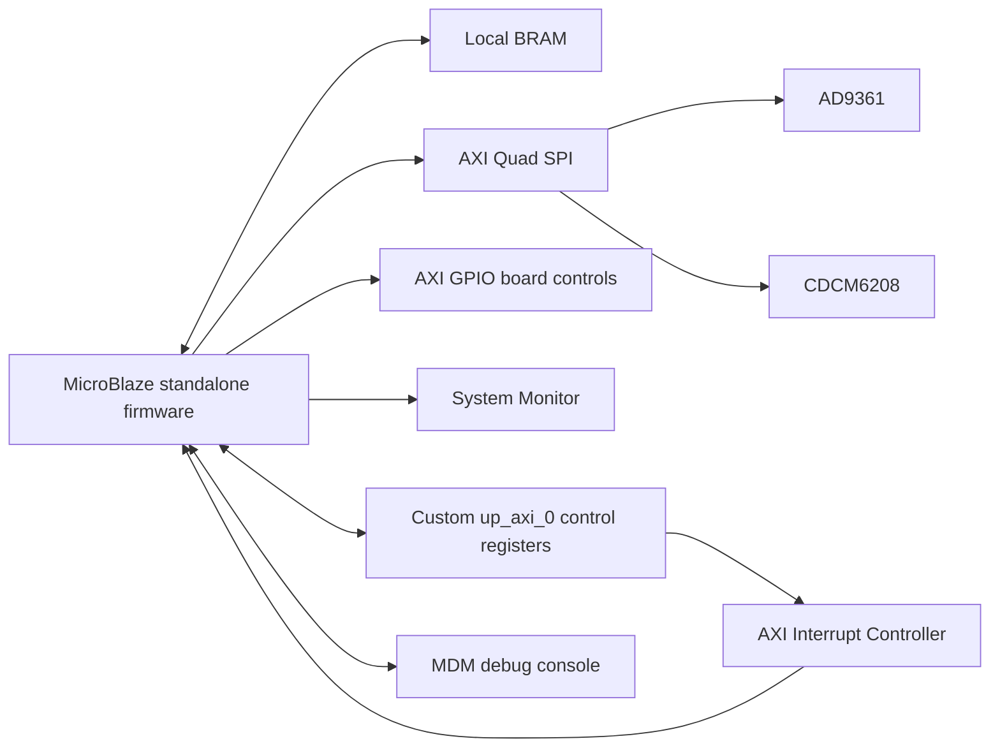

# AD9361 SDR Bring-Up on MicroBlaze and Virtex UltraScale+

Bare-metal C firmware and Vivado hardware sources for bringing up an **AD9361 RF transceiver** from a
**MicroBlaze soft-core processor** in a Vivado block design targeting a
**Xilinx Virtex UltraScale+ XCVU9P FPGA**.

The application initializes board GPIO, the CDCM6208 clock generator, and the
AD9361; applies RX/TX settings and FIR filters; reads temperature and GPS
telemetry; and handles FPGA control commands through an interrupt-driven
AXI-Lite mailbox. It uses the Xilinx standalone BSP and Analog Devices no-OS
driver sources. No operating system is required.

## Hardware and software baseline

| Item | Configuration in this repository |
| --- | --- |
| FPGA handoff target | `xcvu9p-flga2104-2-i` (Virtex UltraScale+) |
| Development environment | Xilinx Vivado / SDK 2018.3; handoff reports `2018.3_AR71948` |
| Processor | `microblaze_0`, MicroBlaze v11.0, little-endian, 100 MHz |
| Runtime | Xilinx standalone BSP 6.8 |
| Program memory | 512 KiB local BRAM; linker reserves the vector region below `0x50` |
| Stack / heap | `0x2800` bytes each in `lscript.ld` |
| RF transceiver | AD9361, two RX and two TX channels, FDD startup configuration |
| AD9361 reference | 20 MHz in `radio_set.c` |
| Clock generator | CDCM6208, board-specific 20 MHz reference register profile |
| Console | BSP stdin/stdout use `mdm_1` through the MicroBlaze debug connection |
| Control peripheral | `up_axi_0`, base address `0x44A40000` in the supplied BSP |

These values describe the supplied handoff and configuration, rather than a
portable board definition. Regenerate the BSP and check the linker script when
changing the block design.

## Block-design architecture



This repository contains the SDK firmware, its existing hardware handoff, and
the organized [Vivado hardware sources](vivado/README.md), including RF datapath
RTL, block design, IP configuration, board constraints, and a Tcl project
recreation script. The supplied RTL and SDK have known register-interface
differences documented in the Vivado README and are not a verified matched
hardware/software release. The HDF archive contains `hwdef.xml`, `system.hwh`,
and `system_bd.tcl`, but does not contain a bitstream.

## Repository layout

```text
.
|-- README.md
|-- vivado/                     Hardware sources and project recreation guide
|-- Mahan3_App/
|   |-- .project / .cproject       SDK application project definitions
|   `-- src/
|       |-- main.c                Board startup and foreground command loop
|       |-- gpio_initial.c/.h     Board GPIO startup levels
|       |-- radio_set.c/.h        AD9361 initialization data and FIR profiles
|       |-- ad9361_config.c/.h    Runtime RF settings and FIR selection
|       |-- interrupt_setup.c     AXI INTC setup and command capture ISR
|       |-- INTR_IRQHandler.h     Interrupt and command-dispatch declarations
|       |-- intr_irq.c            Host/FPGA command dispatcher
|       |-- spi_ctrl.c/.h         CDCM6208 and AUXDAC1 helpers
|       |-- platform.c/.h         Xilinx SPI/GPIO/delay adaptation
|       |-- parameters.h          BSP device IDs and board GPIO bit positions
|       |-- io_control.h          32-bit AXI-Lite access helpers
|       |-- gps_read.c/.h         FPGA GPS telemetry decoding
|       |-- xadc.c/.h             FPGA temperature monitoring
|       |-- ad9361* / util*       Analog Devices driver and utility sources
|       `-- lscript.ld            MicroBlaze memory layout
|-- Mahan3_App_bsp/
|   |-- system.mss                Standalone OS and driver configuration
|   `-- .sdkproject               Hardware project and processor references
`-- adaloop_top_hw_platform_0/
    |-- .project                  SDK hardware project definition
    `-- system.hdf                Canonical hardware handoff
```

SDK project names are retained so that application, BSP, and hardware references
remain valid. GPIO functions and radio configuration data are defined in `.c`
files, with declarations in the corresponding headers.

Generated processor BSP files, `Debug/` and `Release/` outputs, Eclipse workspace
state, logs, and hardware images are excluded by `.gitignore`. Existing local
copies remain on disk. The root `adaloop_top.hdf` is an identical local duplicate
of the tracked hardware project's `system.hdf` and is also ignored.

## Build in Xilinx SDK 2018.3

For Vivado project recreation, architecture, constraints, and hardware validation
status, see [vivado/README.md](vivado/README.md). The steps below build the firmware
against the existing SDK handoff.

1. Clone the repository and open Xilinx SDK 2018.3 with a fresh workspace outside
   the repository.
2. Select **File > Import > General > Existing Projects into Workspace**, choose
   this repository as the root, and import `adaloop_top_hw_platform_0`,
   `Mahan3_App_bsp`, and `Mahan3_App`. Leave **Copy projects into workspace**
   unchecked when building directly from the checkout.
3. Regenerate the BSP for `microblaze_0` from `Mahan3_App_bsp/system.mss` using
   **Re-generate BSP Sources**. The generated `microblaze_0/include`, `libsrc`,
   and `lib` directories are intentionally absent from Git.
4. Build the BSP, then select the application's **Debug** or **Release** build
   configuration and build `Mahan3_App`. SDK regenerates the managed makefiles
   and includes all `.c` sources, including `gpio_initial.c` and `radio_set.c`.
5. The resulting image is `Mahan3_App/Debug/Mahan3_App.elf` or
   `Mahan3_App/Release/Mahan3_App.elf`.

The build uses the MicroBlaze compiler (`mb-gcc`), the regenerated BSP's
`libxil`, and the supplied linker script. Modern Vitis platform migration is
outside the current SDK project setup. No simulation step is needed.

## Program and run

1. Connect the board's JTAG/debug interface and provide the board's required
   power and reference clocks.
2. Program a bitstream that matches the board and the tracked hardware handoff.
   Hardware images are distributed separately from the source repository.
3. Use SDK **Run As > Launch on Hardware (System Debugger)**, or an equivalent
   MicroBlaze debug launch, to download and run the application ELF.
4. View the SDK debug console associated with `mdm_1`. The BSP also includes an
   AXI UART Lite driver, but it is not the selected stdout device in `system.mss`.

The local workspace originally contained `ELCOM_TopM.bit`. Its header identifies
`xcvu9p-flga2104-2-e` and Vivado 2025.2, whereas the tracked HDF identifies
`xcvu9p-flga2104-2-i` and 2018.3. That image is ignored by Git; compatibility with
the handoff has not been established. Use a matched hardware export and image.

## Startup sequence and RF defaults

1. Configure board GPIO outputs and startup levels.
2. Program the CDCM6208 using SPI phase 0, wait for register 21's low nibble to
   become zero, and pulse the clock synchronization output.
3. Switch to SPI phase 1, initialize the AD9361, and apply the board TX delay.
4. Apply the runtime RF values below and program AUXDAC1.
5. Connect the FPGA command IRQ, set the AXI-Lite control and delay registers,
   and initialize the temperature monitor.
6. Report clock status, FPGA/AD9361 temperature, and FPGA-provided GPS data.
7. Enter the foreground loop, retain the existing input-delay reload sequence,
   and execute captured commands.

| Runtime setting | Startup value |
| --- | --- |
| Sampling rate | 61.44 MSPS |
| TX LO | 100 MHz |
| RX LO | 80 MHz |
| TX and RX RF bandwidth | 56 MHz |
| RX gain control | Manual, both channels |
| RX gain | 1 dB, both channels |
| TX attenuation | 0 millidecibels, both channels |
| AUXDAC1 target | 1482 mV |

Edit these runtime defaults in `main.c`. The initial driver configuration in
`radio_set.c` has its own LO, bandwidth, and clock-chain values; `ad9361_config()`
applies the runtime defaults after `ad9361_init()`.

`ad9361_set_sample()` selects paired RX/TX FIR profiles: factor 2 with 64 taps
above 53,333,333 Hz through 61.44 MHz; factor 2 with 96 taps from 40 MHz; factor 2
with 128 taps from 20 MHz; and factor 4 with 128 taps below 20 MHz. These are the
existing selection rules, not input validation or measured RF performance.

## AXI-Lite command interface

Register numbers below are **32-bit word indices**. The C access helpers take
byte offsets, so the firmware multiplies each index by four.

| Word index | Firmware use |
| --- | --- |
| 52 | IRQ acknowledgement pulse in the ISR; also used by legacy command 65 |
| 54 | Command header: RF identifier `[15:12]`, write/read field `[11:8]`, command `[7:0]` |
| 55 / 56 | Request payload, low / high 32-bit words |
| 57 | Command-complete pulse |
| 58 / 59 | Response payload, low / high 32-bit words |
| 100 | FPGA firmware version |
| 101-110 | GPS time, latitude, longitude, altitude, and status word pairs |

The ISR snapshots the command, sets `fsm` to `CMD_IRQ`, and pulses the board IRQ
acknowledgement. The foreground dispatcher executes the operation, returns the
state to `IDEL` (the original identifier), writes the 64-bit response, and pulses
command-complete. The interface has one command slot; it does not implement a
software command queue.

`intr_irq.c` is the command reference. It covers register access, LO frequencies,
sample rate, bandwidth, RX gain, TX attenuation, PPS/time control, FIFO counters,
GPS telemetry, and firmware identification. Command numbers and register values
are retained from the existing firmware and must match the external FPGA/host
implementation.

## Existing behavior and validation scope

- Clock lock polling has no timeout. Several initialization and RF API return
  values are not checked, so a successful build does not establish board health.
- MicroBlaze delays use a legacy busy loop whose timing depends on CPU clock and
  compiler optimization. The ISR retains its 1 ms delay and diagnostic print.
- ISR/foreground shared state retains the original synchronization approach.
  Confirm command timing and interrupt behavior on hardware before relying on
  sustained command traffic.
- Commands 31 and 81 retain existing switch fall-through into commands 32 and
  100, respectively; later cases overwrite the response. Index 52 has overlapping
  legacy uses. These behaviors require the matching FPGA/host specification
  before changing the protocol.
- GPS display conversion retains a fixed UTC+8 offset without date rollover.
  Some clock messages still say 10 MHz and version strings contain legacy board
  identifiers/dates; the configured reference is 20 MHz.

This cleanup preserves board programming values, FIR coefficients, and command
behavior. Simulation and new on-board RF validation are not part of the cleanup.

Build checks used the installed SDK 2018.3 `mb-gcc` 7.3.1 cross-compiler, the
existing local generated BSP headers/library, and the tracked linker script.
All 13 application `.c` files were compiled directly and linked into fresh ELFs
under the ignored `.validation/` directory. This verifies compilation and
linking against the local BSP; importing a clean workspace and regenerating its
BSP were not exercised.

| Configuration | Optimization | Compile / link | `text` / `data` / `bss` bytes |
| --- | --- | --- | --- |
| Debug | `-O0` | Passed | 187048 / 4688 / 21520 |
| Release (SDK project setting) | `-O1` | Passed | 148884 / 4688 / 21524 |
| Additional optimization check | `-O2` | Passed | 146732 / 4688 / 21524 |

Both configurations report two existing warnings in the unchanged `ad9361.c`
driver: unused `tx` and unused `ad9361_int_loopback_fix_ch_cross`. Release also
reports that `vco_div` may be used uninitialized. The build is not warning-free;
the driver warning remains an item for a separate functional review.

A comparison against the initial source commit also confirmed the unchanged
startup/command function bodies, GPIO register sequence, AD9361 initializer,
and FIR coefficients after relocating the definitions. Core AD9361 driver
sources and the hardware handoff are unchanged.

## Source attribution

Analog Devices driver sources retain their original copyright and license
headers. Xilinx-generated project files retain their existing notices. Original
board-code author annotations are preserved where present. Refer to the notices
in individual files for their applicable terms; this repository does not assign
a new blanket license to third-party code.
