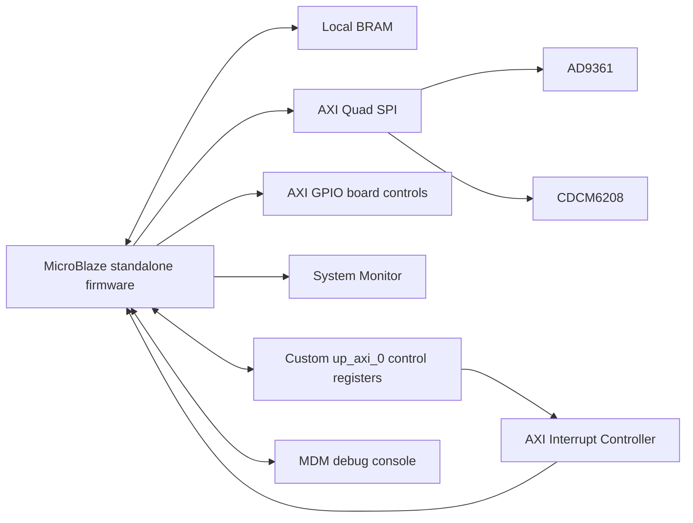

# AD9361 MicroBlaze SDK firmware

Bare-metal C firmware for bringing up an **AD9361 RF transceiver** from a
**MicroBlaze soft-core processor** in a Vivado block design targeting a
**Xilinx Virtex UltraScale+ XCVU9P FPGA**.

The application initializes board GPIO, the CDCM6208 clock generator, and the
AD9361; applies RX/TX settings and FIR filters; reads temperature and GPS
telemetry; and handles FPGA control commands through an interrupt-driven
AXI-Lite mailbox. It uses the Xilinx standalone BSP and Analog Devices no-OS
driver sources. No operating system is required.

This directory contains the application, standalone BSP configuration, and SDK
hardware handoff. The MicroBlaze processor itself is instantiated in the sibling
[Vivado hardware directory](../vivado/README.md). See the
[repository overview](../README.md) for the hardware/software directory split.

## Hardware and software baseline

| Item | Configuration in this repository |
| --- | --- |
| FPGA handoff target | `xcvu9p-flga2104-2-i` (Virtex UltraScale+) |
| Development environment | Xilinx Vivado / SDK 2018.3; handoff reports `2018.3_AR71948` |
| Processor | `microblaze_0`, MicroBlaze v11.0, little-endian, 100 MHz |
| Runtime | Xilinx standalone BSP 6.8 |
| Program memory | 512 KiB local BRAM; linker reserves the vector region below `0x50` |
| Stack / heap | `0x2800` bytes each in `lscript.ld` |
| RF transceiver | AD9361, two RX and two TX channels, FDD startup configuration |
| AD9361 reference | 20 MHz in `radio_set.h` |
| Clock generator | CDCM6208, board-specific 20 MHz reference register profile |
| Console | BSP stdin/stdout use `mdm_1` through the MicroBlaze debug connection |
| Control peripheral | `up_axi_0`, base address `0x44A40000` in the supplied BSP |

These values describe the supplied handoff and configuration, rather than a
portable board definition. Regenerate the BSP and check the linker script when
changing the block design.

## Block-design architecture



This directory contains the SDK firmware and its existing hardware handoff.
The sibling [Vivado hardware sources](../vivado/README.md) include RF datapath
RTL, block design, IP configuration, board constraints, and a Tcl project
recreation script. The command/result mailbox in the RTL and firmware now
shares the CAL2 interface described below. The original HDF is retained; it
contains `hwdef.xml`, `system.hwh` and `system_bd.tcl`, without a bitstream.
A newly implemented/exported 2018.3 board release is outside this source update.

## SDK directory layout

```text
sdk/
|-- README.md
|-- Mahan3_App/
|   |-- .project / .cproject       SDK application project definitions
|   `-- src/
|       |-- main.c                Board startup and foreground command loop
|       |-- gpio_initial.h        Board GPIO startup levels
|       |-- radio_set.h           AD9361 initialization data and FIR profiles
|       |-- ad9361_config.c/.h    Runtime RF settings and FIR selection
|       |-- interrupt_setup.c     AXI INTC setup and command capture ISR
|       |-- INTR_IRQHandler.h     Interrupt and command-dispatch declarations
|       |-- intr_irq.c            Host/FPGA command dispatcher
|       |-- calibrator_verify.h   TX LO programming, SPI readback and lock checks
|       |-- spi_ctrl.c/.h         CDCM6208 and AUXDAC1 helpers
|       |-- platform.c/.h         Xilinx SPI/GPIO/delay adaptation
|       |-- parameters.h          BSP device IDs and board GPIO bit positions
|       |-- io_control.h          32-bit AXI-Lite access helpers
|       |-- gps_read.c/.h         FPGA GPS telemetry decoding
|       |-- xadc.c/.h             FPGA temperature monitoring
|       |-- ad9361* / util*       Analog Devices driver and utility sources
|       `-- lscript.ld            MicroBlaze memory layout
|-- Mahan3_App_bsp/
|   |-- system.mss                Standalone OS and driver configuration
|   `-- .sdkproject               Hardware project and processor references
`-- adaloop_top_hw_platform_0/
    |-- .project                  SDK hardware project definition
    `-- system.hdf                Canonical hardware handoff
```

SDK project names are retained so that application, BSP, and hardware references
remain valid. The final workspace defines GPIO startup and radio configuration
in `gpio_initial.h` and `radio_set.h`. The earlier repository-only
`gpio_initial.c` and `radio_set.c` copies are removed to avoid duplicate
definitions. The legacy global declarations require `-fcommon` when using a
compiler whose default is `-fno-common`; the supplied build helper sets it.

Generated processor BSP files, `Debug/` and `Release/` outputs, Eclipse workspace
state, logs, and hardware images are excluded by `.gitignore`. Existing local
copies remain in the original local SDK workspace. Its `adaloop_top.hdf` is an
identical local duplicate of the tracked hardware project's `system.hdf` and is
also ignored.

## Build in Xilinx SDK 2018.3

For Vivado project recreation, architecture, constraints, and hardware validation
status, see the [Vivado guide](../vivado/README.md). The steps below build the
firmware against the existing SDK handoff.

1. Clone the repository and open Xilinx SDK 2018.3 with a fresh workspace outside
   the repository.
2. Select **File > Import > General > Existing Projects into Workspace**, choose
   **`<repository>/sdk`** as the root, and import `adaloop_top_hw_platform_0`,
   `Mahan3_App_bsp`, and `Mahan3_App`. Leave **Copy projects into workspace**
   unchecked when building directly from the checkout.
3. Regenerate the BSP for `microblaze_0` from `Mahan3_App_bsp/system.mss` using
   **Re-generate BSP Sources**. The generated `microblaze_0/include`, `libsrc`,
   and `lib` directories are intentionally absent from Git.
4. Build the BSP, then select the application's **Debug** or **Release** build
   configuration and build `Mahan3_App`. SDK regenerates the managed makefiles
   and includes the 11 application `.c` sources. Keep the final header-based
   definitions; do not restore the removed duplicate `.c` files.
5. From the repository root, the resulting image is
   `sdk/Mahan3_App/Debug/Mahan3_App.elf` or
   `sdk/Mahan3_App/Release/Mahan3_App.elf`.

Other relative SDK project paths in this guide are relative to `sdk/`. Import all
three projects together into a fresh workspace after updating an older checkout
to this layout. Their project names, BSP references, and sibling include/library
paths are unchanged.

The build uses the MicroBlaze compiler (`mb-gcc`), the regenerated BSP's
`libxil`, and the supplied linker script. Modern Vitis platform migration is
outside the current SDK project setup.

For a command-line build after BSP generation, run from the repository root:

```text
python sdk/Mahan3_App/build_verified_firmware.py
```

It prefers SDK 2018.3 `mb-gcc`; set `MB_GCC` or use `--compiler` for another
installation. The output ELF, build log and SHA-256 source/build manifest are
written under `.validation/firmware_build`. `--publish` copies that ELF into the
ignored application `Release` directory and backs up an existing ELF under
`.validation`. It does not change the tracked C sources or hardware handoff.

## Program and run

1. Connect the board's JTAG/debug interface and provide the board's required
   power and reference clocks.
2. Program a bitstream that matches the board and the tracked hardware handoff.
   Hardware images are distributed separately from the source repository.
3. Use SDK **Run As > Launch on Hardware (System Debugger)**, or an equivalent
   MicroBlaze debug launch, to download and run the application ELF.
4. View the SDK debug console associated with `mdm_1`. The BSP also includes an
   AXI UART Lite driver, but it is not the selected stdout device in `system.mss`.

The local workspace originally contained `ELCOM_TopM.bit`. Its header identifies
`xcvu9p-flga2104-2-e` and Vivado 2025.2, whereas the tracked HDF identifies
`xcvu9p-flga2104-2-i` and 2018.3. That image is ignored by Git; compatibility with
the handoff has not been established. Use a matched hardware export and image.

## Startup sequence and RF defaults

1. Configure board GPIO outputs and startup levels.
2. Program the CDCM6208 using SPI phase 0, wait for register 21's low nibble to
   become zero, and pulse the clock synchronization output.
3. Switch to SPI phase 1, initialize the AD9361, and apply the board TX delay.
4. Apply the runtime RF values below and program AUXDAC1.
5. Connect the FPGA command IRQ, set the AXI-Lite control and delay registers,
   and initialize the temperature monitor.
6. Report clock status, FPGA/AD9361 temperature, and FPGA-provided GPS data.
7. Enter the foreground loop, retain the existing input-delay reload sequence,
   and execute captured commands.

| Runtime setting | Startup value |
| --- | --- |
| Sampling rate | 61.44 MSPS |
| TX LO | 100 MHz |
| RX LO | 80 MHz |
| TX and RX RF bandwidth | 56 MHz |
| RX gain control | Manual, both channels |
| RX gain | 1 dB, both channels |
| TX attenuation | 0 millidecibels, both channels |
| AUXDAC1 target | 1482 mV |

Edit these runtime defaults in `main.c`. The initial driver configuration in
`radio_set.h` has its own LO, bandwidth, and clock-chain values; `ad9361_config()`
applies the runtime defaults after `ad9361_init()`.

`ad9361_set_sample()` selects paired RX/TX FIR profiles: factor 2 with 64 taps
above 53,333,333 Hz through 61.44 MHz; factor 2 with 96 taps from 40 MHz; factor 2
with 128 taps from 20 MHz; and factor 4 with 128 taps below 20 MHz. These are the
existing selection rules, not input validation or measured RF performance.

## AXI-Lite command interface

These are **internal 32-bit word indices** relative to `0x44A40000`, not Mahan
host command-register addresses. Byte offset = word index * 4.

| Word | Read | Write |
| --- | --- | --- |
| 52 | IRQ clear control | IRQ acknowledgement; does not complete the command |
| 54 | Latched command header | Unimplemented |
| 55 / 56 | Latched request payload, low / high | Unimplemented |
| 57 | `[2]` sticky overflow, `[1]` busy, `[0]` done pulse | Bit 0 commits staged result only while busy with a matching token |
| 58 / 59 | Completed result, low / high | Stage result, low / high |
| 60 | Current command sequence | Stage completion sequence token |
| 61 | Completed error code | Stage error code |
| 62 | Completed sequence | Unimplemented |
| 63 | `0x43414C32` (`CAL2`) | Unimplemented |

The ISR captures the latched request and its sequence, then acknowledges the
interrupt without the previous 1 ms delay. Shared command/FSM state is volatile.
The foreground dispatcher executes the command, stages the result, token and
error, and commits word 57. A stale token cannot release the busy mailbox.
Only one command may be outstanding: the caller must wait for `cmd_ready` and
provide the request with the required clock-domain synchronization. A trigger
while busy is rejected and sets sticky overflow until reset.

### TX LO verification

Write command 2 uses `calibrator_verify.h` to clear only the software TX LO
rate cache before calling the setter. Retrying the same frequency therefore
performs real programming. It reads five PLL integer/fraction bytes and the
RFPLL divider, calculates the resulting frequency using the TX reference,
checks a 100 Hz tolerance, then requires four consecutive VCO-lock reads.
The lock loop permits up to 2000 polls with 10 us delays, plus SPI execution
time. Error propagation from the TX PLL driver is retained.

| Error | Meaning |
| --- | --- |
| 0 | Verified success |
| 6 | TX LO setter failed |
| 7 | Frequency readback outside tolerance |
| 8 | Stable lock not obtained |
| 10 | SPI/readback failure or invalid reference |
| 11 | Unsupported external LO or active fastlock profile |

Controller timeout code 9 belongs to the Mahan parent FPGA controller, which
is not included here. No retry limit or RF-level threshold is configured by
this firmware snapshot.

## Remaining legacy behavior

- Firmware/GPS word indices 100-110 are still read by legacy code but are not
  implemented in this local RTL; reads return `0xAABBCCDD`.
- Legacy commands 64/66 use words 61/60 with older meanings. Those addresses now
  belong to the verified mailbox. They are not supported board controls in
  this CAL2 interface and must be reviewed before use.
- Clock startup lock polling has no timeout. Some unrelated RF commands retain
  unchecked API returns. Command 31 and 81 switch fall-through and the GPS
  display's UTC+8 conversion are retained from the final local source.
- Initialization values, FIR coefficients and unrelated command behavior are
  copied from the final local SDK, including its header-based definitions.

## Validation

The final 11 C translation units compile and link with SDK 2018.3 `mb-gcc` 7.3.1,
`-O1 -fcommon`, the existing generated BSP and the supplied linker script.
The portable build helper records the compiler and hashes in its build manifest.
A clean-workspace BSP regeneration was not part of this check.

The build retains warnings for unused driver/local variables, possibly
uninitialized legacy `vco_div`, and the legacy implicit `interrupt_setup`
declaration. Passing compilation does not mean the source is warning-free.
The paired hardware mailbox simulation passes under native Vivado 2018.3.
Full implementation, timing closure and a matched new hardware export are
separate release steps. See the [hardware guide](../vivado/README.md).

## Source attribution

Analog Devices driver sources retain their original copyright and license
headers. Xilinx-generated project files retain their existing notices. Original
board-code author annotations are preserved where present. Refer to the notices
in individual files for their applicable terms; this repository does not assign
a new blanket license to third-party code.
