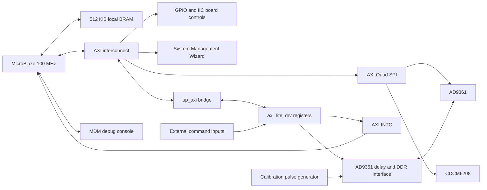

# AD9361 / MicroBlaze Vivado sources

Source archive and project recreation flow for the **RFMC6000 / ORIHARD FMC2**
design targeting **`xcvu9p-flga2104-2-i`**. The original project is named
`rfmc6000_orihard_modified`; its top module is `adaloop_top`.

Use **Vivado 2018.3**, with the original installation reporting
**2018.3_AR71948**. This directory accompanies the SDK firmware in the sibling
[`sdk/` directory](../sdk/README.md). The firmware and this hardware snapshot have
known interface differences listed below; their coexistence does not establish
a matched board release.

## Layout

```text
vivado/
|-- README.md
|-- rtl/                        Five original Verilog source modules
|-- bd/system.bd                MicroBlaze block design
|-- ip/
|   |-- dds1/dds1.xci            DDS Compiler 6.0 configuration
|   |-- ila_0/ila_0.xci          ILA 6.2 configuration
|   |-- ila_pulse_gen/ila_pulse_gen.xci
|   `-- vio_0/vio_0.xci          VIO 3.0 configuration
|-- constraints/
|   |-- rfmc6000_orihard_FMC2.xdc  Selected pin/timing constraints
|   `-- legacy/                 Three historical XDC files, not loaded
|-- scripts/create_project.tcl
`-- build/                      Generated projects and products, ignored by Git
```

| RTL module | Responsibility |
| --- | --- |
| `adaloop_top.v` | Connects the processor subsystem, board controls, RF I/O, and calibration pulse generator |
| `up_axi.v` | AXI-Lite slave bridge used as an RTL module reference in the block design |
| `axi_lite_drv.v` | Local control/status registers and command interrupt logic |
| `axi_ad9361_dev_if_idelay.v` | Differential AD9361 RX/TX interface, DDR capture/output, and programmable input delay |
| `ad_iobuf.v` | Bidirectional board GPIO buffers |

The `.bd` and `.xci` descriptors are the configuration sources. Vivado regenerates
wrappers, IP HDL, checkpoints, hardware handoffs, and run files. Cached vendor
HDL and output products are intentionally excluded.

## Recreate the project

Run from the repository root in a shell with Vivado 2018.3 on `PATH`:

```text
vivado -mode batch -nojournal -nolog -source vivado/scripts/create_project.tcl
```

For PowerShell with the default Windows installation:

```powershell
& 'C:\Xilinx\Vivado\2018.3\bin\vivado.bat' -mode batch -nojournal -nolog -source vivado/scripts/create_project.tcl
```

The script creates:

```text
vivado/build/ad9361_microblaze/ad9361_microblaze.xpr
```

It adds the five RTL files, imports copies of the BD and four XCI descriptors,
selects the FMC2 XDC, validates the BD, generates BD output products, and writes
`ip_status.rpt` inside the generated project directory. The tracked BD/XCI files
are not rewritten. The script uses the installed Xilinx IP catalog and the local
`up_axi.v` module; no external custom IP repository is needed for this flow.

An existing output directory is rejected to protect local work. To create another
project, supply a new output directory after `-tclargs`:

```text
vivado -mode batch -nojournal -nolog -source vivado/scripts/create_project.tcl -tclargs vivado/build/review
```

Open the generated `.xpr` in Vivado to inspect the design. The retained standalone
DDS/ILA/VIO configurations have commented-out instantiations in the supplied top;
the script does not re-enable them or generate their output products. Generate
those products if you deliberately re-enable the corresponding instances.

The original project selected `constrs_2` for both synthesis and implementation.
The recreated project loads that same FMC2 XDC into its default `constrs_1` set.
The other three XDC files are retained for reference and must not be combined
with the active board pin map without review.

## Architecture



`Clk_in_100M` feeds the block-design clock wizard, which provides 100 MHz and
200 MHz clocks. The AD9361 differential RX clock drives the RF datapath through
`IBUFDS` and a software-controlled `BUFGCE`. The XDC declares a 10 ns system-clock
period and a 4 ns RX-clock period; these are constraint values, not measurements.

The supplied top sends the calibration generator's four 12-bit sample values to
the TX interface. `Calib_En`, `PW`, and `PRI` control the pulse in RX-clock cycles;
the active portion uses sample value 2047 and the inactive portion uses zero.
The older `rf_mode` sample-selection logic remains in the source, but its sample
outputs are disconnected from the TX instance. The DDS instance is commented out.

## Processor address map

Values below come from `bd/system.bd`.

| Peripheral | Base address | Range |
| --- | --- | --- |
| Local BRAM, instruction and data | `0x00000000` | 512 KiB |
| AXI GPIO | `0x40000000` | 64 KiB |
| AXI UART Lite | `0x40600000` | 64 KiB |
| AXI IIC | `0x40800000` | 64 KiB |
| AXI interrupt controller | `0x41200000` | 64 KiB |
| MDM | `0x41400000` | 4 KiB |
| AXI Quad SPI | `0x44A00000` | 64 KiB |
| System Management Wizard | `0x44A10000` | 64 KiB |
| `up_axi_0` | `0x44A40000` | 64 KiB |

### Local control registers

Indices are 32-bit words relative to `0x44A40000`: byte offset = index × 4.
The decoder uses address bits `[15:2]`.

| Word | Read | Write |
| --- | --- | --- |
| 0 | `sdr_info` (`0x00006000` in the top) | Unimplemented |
| 1 | `mtime_start` | Enable/reset datapath sequencing |
| 2 | `pps_select` | PPS selector storage |
| 3 | `phase` | Phase increment storage |
| 4 | `rf_mode` | Legacy sample-mode selector |
| 5 | `clock_1pps` | Clock-count storage, reset value 61,440,000 |
| 20 | `idly_en_vtc` | Delay VTC bits `[6:0]` |
| 21 | `idly_load` | Delay load bits `[6:0]` |
| 22 | `idly_d` | Delay value `[8:0]` |
| 23 | AD9361 `ctrl_out[7:0]` | AD9361 `ctrl_in[3:0]` |
| 26 | Default read value | RF clock-buffer enable |
| 28 | `adc_status` | Unimplemented |
| 52 | `irq_ctrl` | IRQ clear control; clear when the entire word equals 1 |
| 53 | `irq_status` | Unimplemented |
| 54 | External `sdr_cmd_param` | Unimplemented |
| 55 | External `sdr_data_low` | Unimplemented |
| 56 | External `sdr_data_high` | Unimplemented |

Other reads return `0xAABBCCDD`; other writes have no register effect.
`CfgSET_Trig` is sampled on the 100 MHz control clock; its detected rising edge
asserts the interrupt until word 52 clears it. The external command words are
read directly from input ports; the RTL does not latch a payload or implement a
command queue. The surrounding logic must provide suitable synchronization and
hold times for these inputs.

## Integration issues retained from the supplied sources

- The SDK dispatcher writes command completion/results at words 57-59 and reads
  firmware/GPS words 100-110. This RTL implements none of those registers. A
  matching surrounding FPGA design or a protocol update is required to support
  those firmware operations; no protocol behavior was invented during cleanup.
- Several top-level integration inputs/outputs have no package-pin assignments
  in the supplied FMC2 XDC, including reset, calibration controls, command words,
  and interrupt acknowledgement. Decide how these connect to the parent design
  before treating `adaloop_top` as a complete standalone board image.
- The XDC retains hierarchy-specific timing exceptions and debug-hub commands.
  Check the target hierarchy and debug-core presence before implementation.
- BD validation reports that `up_axi_0/up_axi` is not associated with a clock
  interface (`BD 41-967`). Its actual `up_clk`/`up_rstn` nets are connected, but
  the RTL interface metadata needs a separate review.
- Vivado reports a missing `temp_out` pin on the System Management Wizard
  (`BD 41-2162`) and an unsourced temperature net (`BD 41-597` / `BD 41-166`).
  The top leaves the BD `temp_out` output open. Reconcile the BD connection and
  monitor configuration if this direct output is required.
- `UART_rxd` is an undriven internal wire; external UART ports are commented
  out. The SDK console selects MDM. `pps_1s` is also unused in this snapshot.
- Pulse parameter limits, clock-domain crossings, input-delay calibration,
  complete I/O constraints, and RF timing still require functional board review.

After resolving integration requirements, run synthesis and implementation and
review timing and DRC reports. Export a matching hardware handoff for SDK 2018.3
and regenerate the BSP if hardware changes. The existing tracked
`sdk/adaloop_top_hw_platform_0/system.hdf` is retained unchanged; this cleanup does
not replace it or assert that it represents the exact supplied RTL snapshot.
Bitstreams and new hardware exports belong in a separately identified matched
release, not among generated files committed with these sources.

## Cleanup and validation

The import preserves all five RTL files, the BD, and four XCI configurations.
Pin assignments and timing values are preserved. Bus port selectors in the FMC2
XDC and historical `rfmc6000.xdc` were enclosed in Tcl braces (for example,
`[get_ports {ctrl_in[0]}]`) to prevent square brackets from being evaluated as
nested Tcl commands.

The original machine-specific `.xpr`, external packaging `component.xml`
reference, and stale IP repository paths are replaced by `create_project.tcl`.
The original working project and its generated files remain outside this Git
repository; this import does not delete them.

Validation used the installed **Vivado 2018.3_AR71948**:

| Check | Result |
| --- | --- |
| Create project from organized sources | Passed |
| BD validation and output-product generation | Completed with the warnings listed above |
| `report_ip_status` | All 22 IP instances reported up to date; no upgrades applied |
| Top-level RTL elaboration (`synth_design -rtl`) | Completed: 0 errors, 82 warnings, 20 critical warnings |
| Full synthesis, implementation, timing closure, bitstream generation | Not performed |
| Simulation and on-board RF validation | Not performed |

RTL elaboration uses black-box stubs for the BD's out-of-context IP. It checks
the top-level RTL/hierarchy; it does not verify internal IP implementation,
placement, routing, or hardware behavior.

Elaboration warnings include unused logic, the undriven UART input, and
unconnected ports. Critical warnings include `Designutils 20-1275` for IP
hierarchy absent from those stubs; hierarchy-specific XDC constraints are also
deferred (`Project 1-498`). These results do not establish successful full
synthesis or timing closure. The installed environment additionally reports
`Common 17-741` about its local Tcl store permissions.

To repeat RTL elaboration after recreation, use the Vivado Tcl console:

```tcl
open_project vivado/build/ad9361_microblaze/ad9361_microblaze.xpr
synth_design -rtl -name rtl_1 -top adaloop_top -part xcvu9p-flga2104-2-i
```

Run those commands from the repository root, or adjust the project path to the
current directory. Close an already open project before `open_project`.

## Attribution

Original Analog Devices and Xilinx notices are preserved in the imported files.
Refer to each file's existing license terms. This cleanup adds no blanket license
for third-party RTL or IP.
