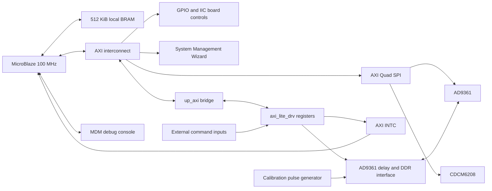

# AD9361 / MicroBlaze Vivado sources

Source archive and project recreation flow for the **RFMC6000 / ORIHARD FMC2**
design targeting **`xcvu9p-flga2104-2-i`**. The original project is named
`rfmc6000_orihard_modified`; its top module is `adaloop_top`.

Use **Vivado 2018.3**, with the original installation reporting
**2018.3_AR71948**. This directory accompanies the SDK firmware in the sibling
[`sdk/` directory](../sdk/README.md). The final hardware and firmware now share a latched, sequence-checked CAL2
command mailbox. The original hardware handoff is retained; a newly exported,
fully implemented 2018.3 board release is outside this source update.

## Layout

```text
vivado/
|-- README.md
|-- rtl/                        Five final Verilog source modules
|-- bd/system.bd                MicroBlaze block design
|-- ip/
|   |-- dds1/dds1.xci            DDS Compiler 6.0 configuration
|   |-- ila_0/ila_0.xci          ILA 6.2 configuration
|   |-- ila_pulse_gen/ila_pulse_gen.xci
|   `-- vio_0/vio_0.xci          VIO 3.0 configuration
|-- constraints/
|   |-- rfmc6000_orihard_FMC2.xdc  Selected pin/timing constraints
|   `-- legacy/                 Three historical XDC files, not loaded
|-- IP_Repo_2018_3/              Local packaged core for parent-design integration
|-- tests/                       Mailbox testbench and native 2018.3 runner
|-- scripts/create_project.tcl
|-- scripts/sync_verified_package_2018.tcl
`-- build/                      Generated projects and products, ignored by Git
```

| RTL module | Responsibility |
| --- | --- |
| `adaloop_top.v` | Connects the processor subsystem, board controls, RF I/O, and calibration pulse generator |
| `up_axi.v` | AXI-Lite slave bridge used as an RTL module reference in the block design |
| `axi_lite_drv.v` | Local control/status registers and command interrupt logic |
| `axi_ad9361_dev_if_idelay.v` | Differential AD9361 RX/TX interface, DDR capture/output, and programmable input delay |
| `ad_iobuf.v` | Bidirectional board GPIO buffers |

The recreation flow uses the `.bd` and `.xci` descriptors are the configuration sources. Vivado regenerates
wrappers, IP HDL, checkpoints, hardware handoffs, and run files. Cached vendor
HDL and output products are intentionally excluded.

## Recreate the project

Run from the repository root in a shell with Vivado 2018.3 on `PATH`:

```text
vivado -mode batch -nojournal -nolog -source vivado/scripts/create_project.tcl
```

For PowerShell with the default Windows installation:

```powershell
& 'C:\Xilinx\Vivado\2018.3\bin\vivado.bat' -mode batch -nojournal -nolog -source vivado/scripts/create_project.tcl
```

The script creates:

```text
vivado/build/ad9361_microblaze/ad9361_microblaze.xpr
```

It adds the five RTL files, imports copies of the BD and four XCI descriptors,
selects the FMC2 XDC, validates the BD, generates BD output products, and writes
`ip_status.rpt` inside the generated project directory. The tracked BD/XCI files
are not rewritten. The script uses the installed Xilinx IP catalog and the local
`up_axi.v` module; no external custom IP repository is needed for this flow.

An existing output directory is rejected to protect local work. To create another
project, supply a new output directory after `-tclargs`:

```text
vivado -mode batch -nojournal -nolog -source vivado/scripts/create_project.tcl -tclargs vivado/build/review
```

On Windows, keep the generated project path short. Vivado 2018.3 IP generation
can exceed the 260-character path limit in a deeply nested checkout. For example,
use `-tclargs C:/ad9361_build` with a new directory when the checkout path is long.

Open the generated `.xpr` in Vivado to inspect the design. The retained standalone
DDS/ILA/VIO configurations have commented-out instantiations in the supplied top;
the script does not re-enable them or generate their output products. Generate
those products if you deliberately re-enable the corresponding instances.

The original project selected `constrs_2` for both synthesis and implementation.
The recreated project loads that same FMC2 XDC into its default `constrs_1` set.
The other three XDC files are retained for reference and must not be combined
with the active board pin map without review.

## Architecture



`Clk_in_100M` feeds the block-design clock wizard, which provides 100 MHz and
200 MHz clocks. The AD9361 differential RX clock drives the RF datapath through
`IBUFDS` and a software-controlled `BUFGCE`. The XDC declares a 10 ns system-clock
period and a 4 ns RX-clock period; these are constraint values, not measurements.

The supplied top sends the calibration generator's four 12-bit sample values to
the TX interface. `Calib_En` crosses through a two-stage DAC-domain synchronizer. `PW` and `PRI`
control the pulse in RX-clock cycles;
the active portion uses sample value 2047 and the inactive portion uses zero.
The older `rf_mode` sample-selection logic remains in the source, but its sample
outputs are disconnected from the TX instance. The DDS instance is commented out.

## Processor address map

Values below come from `bd/system.bd`.

| Peripheral | Base address | Range |
| --- | --- | --- |
| Local BRAM, instruction and data | `0x00000000` | 512 KiB |
| AXI GPIO | `0x40000000` | 64 KiB |
| AXI UART Lite | `0x40600000` | 64 KiB |
| AXI IIC | `0x40800000` | 64 KiB |
| AXI interrupt controller | `0x41200000` | 64 KiB |
| MDM | `0x41400000` | 4 KiB |
| AXI Quad SPI | `0x44A00000` | 64 KiB |
| System Management Wizard | `0x44A10000` | 64 KiB |
| `up_axi_0` | `0x44A40000` | 64 KiB |

### Local control registers

Indices are 32-bit words relative to `0x44A40000`: byte offset = index × 4.
The decoder uses address bits `[15:2]`.

| Word | Read | Write |
| --- | --- | --- |
| 0 | `sdr_info` (`0x00006000` in the top) | Unimplemented |
| 1 | `mtime_start` | Enable/reset datapath sequencing |
| 2 | `pps_select` | PPS selector storage |
| 3 | `phase` | Phase increment storage |
| 4 | `rf_mode` | Legacy sample-mode selector |
| 5 | `clock_1pps` | Clock-count storage, reset value 61,440,000 |
| 20 | `idly_en_vtc` | Delay VTC bits `[6:0]` |
| 21 | `idly_load` | Delay load bits `[6:0]` |
| 22 | `idly_d` | Delay value `[8:0]` |
| 23 | AD9361 `ctrl_out[7:0]` | AD9361 `ctrl_in[3:0]` |
| 26 | Default read value | RF clock-buffer enable |
| 28 | `adc_status` | Unimplemented |
| 52 | `irq_ctrl` | IRQ clear control; clear when the entire word equals 1 |
| 53 | `irq_status` | Unimplemented |
| 54 | Latched `sdr_cmd_param` | Unimplemented |
| 55 / 56 | Latched request, low / high | Unimplemented |
| 57 | Overflow/busy/done in bits 2/1/0 | Bit 0 commits staged reply with matching sequence |
| 58 / 59 | Completed reply, low / high | Stage reply, low / high |
| 60 | Accepted command sequence | Stage completion sequence |
| 61 | Completed reply error | Stage error |
| 62 | Completed reply sequence | Unimplemented |
| 63 | `0x43414C32` (`CAL2`) | Unimplemented |

Other reads return `0xAABBCCDD`; other writes have no register effect.
These word indices are internal processor addresses, separate from Mahan
software command-register numbering.

## Verified command path

The caller holds a synchronized request and raises `CfgSET_Trig` when
`cmd_ready` is high. The RTL captures all 96 request bits, increments the
sequence, asserts busy and requests a MicroBlaze interrupt. Payload reads stay
stable even if external command inputs change. IRQ acknowledgement clears the
interrupt only; it does not mean that RF programming has finished.

The firmware stages the 64-bit result, sequence and error, then commits word
57. Completion is accepted only for the outstanding sequence. The top exposes
`cmd_ready`, `cmd_busy`, one-cycle `cmd_done`, sticky `cmd_overflow`,
`cmd_sequence`, `reply_sequence`, `reply_command`, `reply_data` and `reply_error`
on the 100 MHz control clock. A parent crossing into another clock domain must
transfer these signals coherently. This is a one-slot mailbox, not a queue.

TX LO verification in the paired firmware includes forced same-frequency
programming, SPI PLL readback and stable lock checks; see the
[firmware guide](../sdk/README.md#tx-lo-verification).
The Mahan parent retry/level controller and Ethernet packet transfer logic
are outside this repository.

## Packaged core

`IP_Repo_2018_3/component.xml` and its local sources contain the native 2018.3
core, including the verified mailbox output ports (revision 2). AXI IIC remains
version 2.0; no 2025 IP migration is applied. Add this directory as an IP
repository when integrating the packaged block into a parent project.

After deliberately editing the wrapper/mailbox, synchronize those two RTL
files and the FMC2 XDC into the local package in Vivado 2018.3:

```tcl
source vivado/scripts/sync_verified_package_2018.tcl
```

This helper updates package ports and checksums. It does not upgrade the BD,
create a parent project or change any external Mahan `IP_Repo`.

## Integration notes

- Legacy firmware/GPS words 100-110 are still absent from the local decoder.
  Their legacy firmware reads do not provide actual GPS/version data here.
- Several top-level integration ports have no standalone package-pin
  assignments, including calibration and command interfaces. Connect these
  inside the parent design; the supplied top is not a complete independent
  board pinout.
- Hierarchy-specific XDC/debug-hub commands require the matching parent
  hierarchy and debug cores. The Calib_En exception targets only the first
  synchronizer stage, leaving the second-stage path timed.
- BD validation reports the existing `BD 41-967` clock-interface metadata
  warning for `up_axi_0/up_axi`, plus clock-domain propagation messages. The
  actual clock/reset nets are connected.
- The legacy System Monitor temperature output and undriven internal UART
  input remain integration review items. The firmware console uses MDM.
- The tracked SDK HDF is unchanged. Export matching hardware and regenerate
  the BSP if the processor subsystem or its address map changes.

## Validation

Run the mailbox regression from the repository root:

```text
python vivado/tests/run_verified_mailbox_2018.py
```

It uses the installed Vivado 2018.3 tools (override the installation root with
`VIVADO_2018`) and writes ignored products under
`.validation/ad9361_2018_mailbox`. It checks stable captured requests,
sequence-matched completion, stale-token rejection, busy overflow, reset,
error replies and a 64-bit 5 GHz result.

Native Vivado 2018.3 checks for this source update:

| Check | Result |
| --- | --- |
| Verified mailbox simulation | Passed |
| Project recreation, BD validation and output generation | Passed with existing integration warnings |
| Local packaged-core synthesis | Passed with 0 errors; existing warnings remain |
| Full implementation, timing closure and new 2018.3 board image | Not performed |

The original native package synthesis reported 12 critical warnings and 286
warnings, including existing interface/constraint integration issues. Successful
synthesis is not a timing-closure claim. The firmware's 11 C files also compile
and link using SDK 2018.3 and the existing generated BSP.

The final local SDK/Vivado sources are the authority for this update. The
repository keeps its portable layout and build helpers. Bus selectors in XDC
use Tcl braces so square brackets are interpreted as part of port names; this
does not alter the selected pins or timing values. Images, checkpoints, logs,
workspace metadata and generated project products remain ignored.

## Attribution

Original Analog Devices and Xilinx notices are preserved in the imported files.
Refer to each file's existing license terms. This cleanup adds no blanket license
for third-party RTL or IP.
